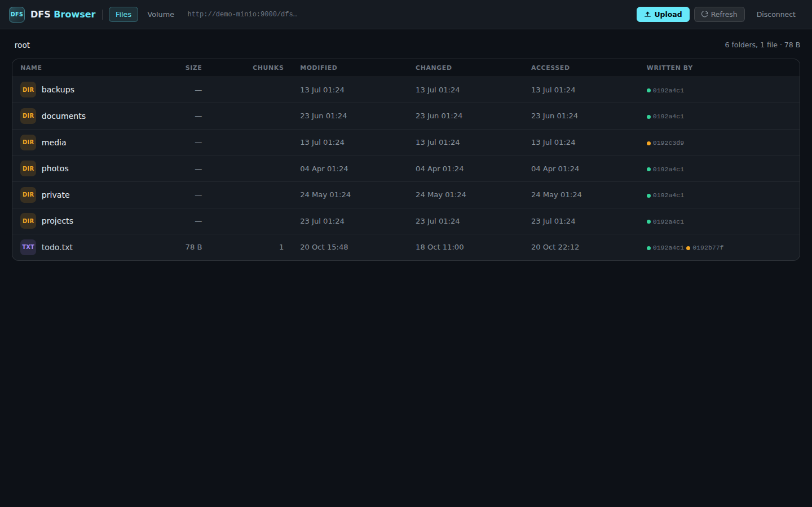
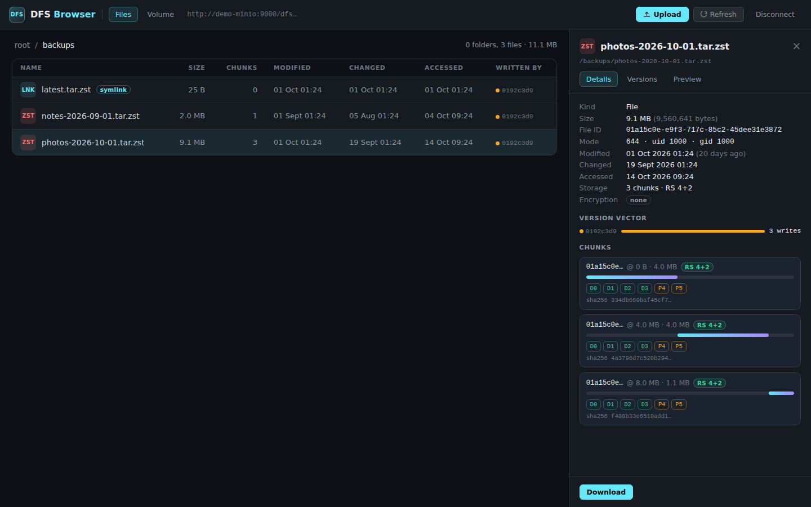
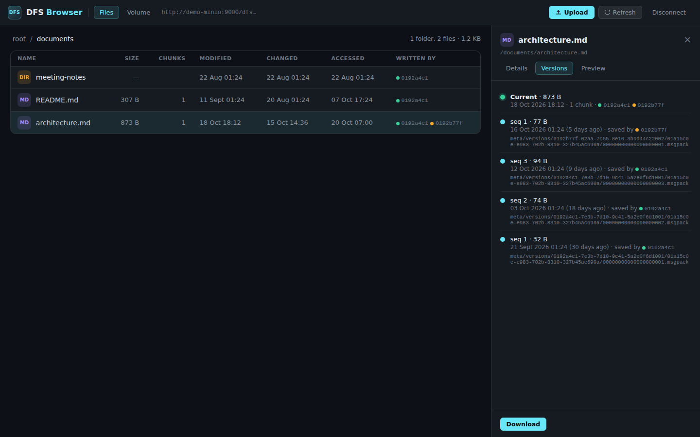
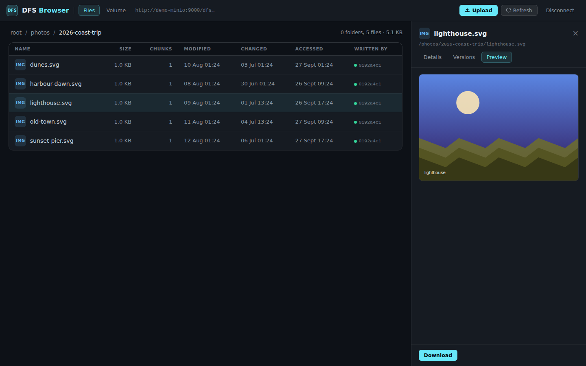
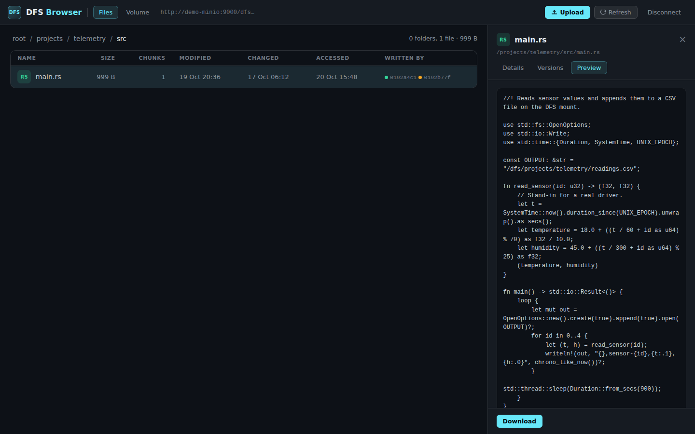
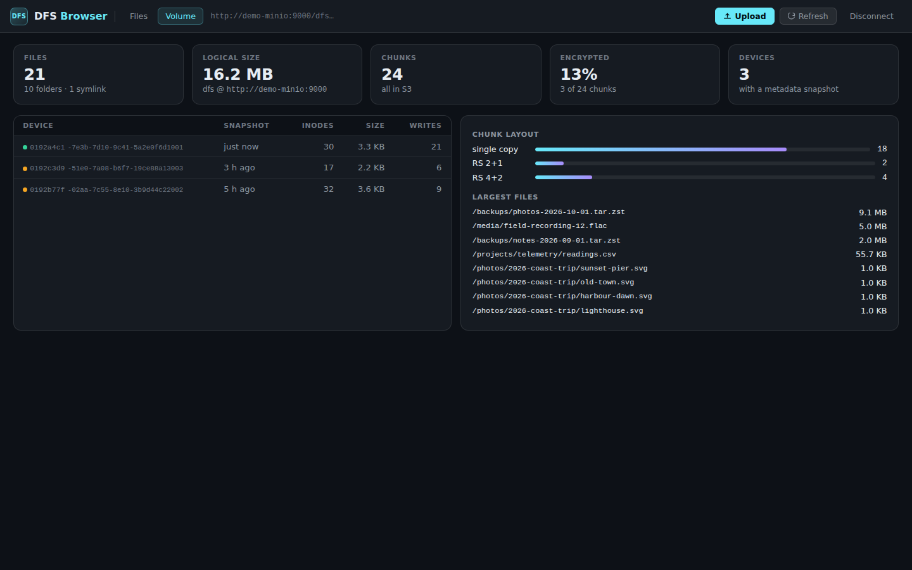
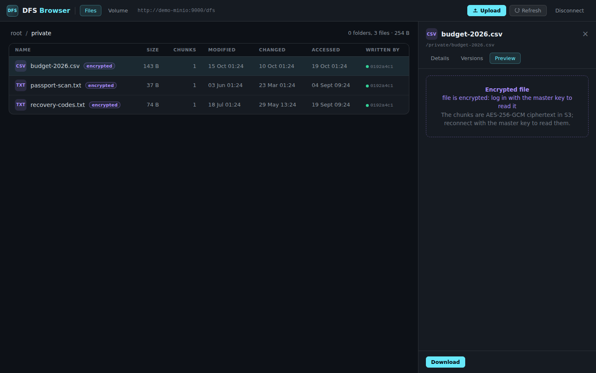
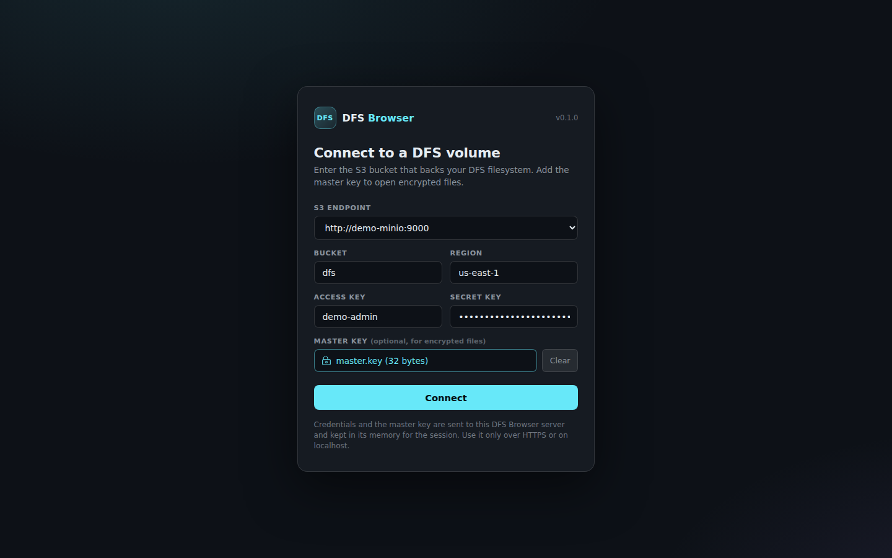

# DFS Browser

**A web UI for looking inside a [DFS](https://github.com/mmiretta/dfs) volume, straight
from its S3 bucket.**

[DFS](https://github.com/mmiretta/dfs) is a distributed FUSE filesystem: every device
mounts the same S3-compatible bucket, writes 4 MiB chunks to it (optionally
AES-256-GCM encrypted and Reed-Solomon erasure-coded across storage nodes), and keeps
its metadata in per-device snapshots and delta logs under `meta/`.

DFS Browser reads those same objects. It needs no mount, no FUSE and no running
daemon: give it the bucket's endpoint and credentials (and the master key, if you want
to open encrypted files) and it shows the directory tree, what every file is made of,
which devices wrote it, its saved versions, and the state of the whole volume.

It is a single Rust binary (actix-web, using the `dfs-daemon` crate for the on-S3
formats) with a framework-free HTML/JS front end compiled into it. A Compose **demo
profile** starts a throwaway MinIO with a synthetic DFS volume, so you can try it in a
minute.



## Features

- **Merged directory tree.** All device snapshots in `meta/snapshots/` are combined into
  one tree, the same way a newly mounted daemon would see it. Each entry shows size,
  chunk count, timestamps, an *encrypted* badge and the devices that wrote it.
- **What a file is made of.** The details panel lists the inode (ID, mode, owner,
  times, xattrs), the version vector per device, and every chunk: offset, length,
  SHA-256, encryption, and for erasure-coded chunks the data and parity shards with
  their S3 keys.
- **Saved versions.** Versions kept under `meta/versions/<device>/<file>/` are listed
  newest first, with size, time and the device that saved them.
- **Previews.** Text and source files and images are shown inline (up to 2 MiB). SVGs
  are rendered through ``, so scripts inside them never run.
- **Encrypted files.** Log in with the `master.key` file and encrypted chunks are
  decrypted on the server. Without it, encrypted files stay listed but locked.
- **Erasure coding.** Files stored as Reed-Solomon shards (`k` data + `m` parity) are
  reconstructed on download, even when some shards are missing.
- **Volume view.** File, folder and chunk counts, logical size, share of encrypted
  chunks, chunk layouts (`single copy`, `RS 4+2`, ...), each device's latest snapshot,
  and the largest files.
- **Uploads.** Files can be dropped into any folder. They are stored the way a daemon
  without a coordinator stores them (one chunk, encrypted if the session has a key) and
  announced with a `FileCreate` delta so running daemons pick them up. Turn this off
  with `DFS_BROWSER_READ_ONLY=true`.
- **Small and locked down.** Distroless non-root image, binds to `127.0.0.1` by
  default, optional HTTP Basic auth, an S3 endpoint allowlist, a strict CSP, and
  expiring sessions held in memory only.

| File details and chunks | Saved versions |
|---|---|
|  |  |

| Image preview | Text preview |
|---|---|
|  |  |

| Volume overview | Encrypted file without the key |
|---|---|
|  |  |

| Login |
|---|
|  |

*All screenshots come from the demo volume. Every file, device and value is synthetic.*

## How it fits with DFS

```
 laptop (dfs mount)      desktop (dfs mount)      nas (dfs mount)
        │                        │                       │
        └──── chunks, shards, snapshots, deltas, versions ┘
                                 │
                         S3 bucket (MinIO, AWS, R2, ...)
                                 │  read (and optionally write)
                          DFS Browser ── HTTP ──► your browser
```

| Object in the bucket | What DFS Browser does with it |
|---|---|
| `meta/snapshots/<device>/latest.msgpack.zstd` | Merges all devices into the tree; listed in the volume view |
| `data/chunks/xx/yy/<chunk>.blk` | Single-copy chunks, read (and decrypted) on download |
| `data/shards/xx/yy/<chunk>.sNN` | Erasure-coded shards, reconstructed on download |
| `meta/versions/<device>/<file>/<seq>.msgpack` | Listed in the *Versions* tab |
| `meta/deltas/<device>/...` | Written once per upload so live daemons see the new file |

The browser always reflects the **latest snapshots**. Changes that a device has
written only as deltas show up once that device uploads its next snapshot. The parsed
tree is cached for 30 seconds per session (*Refresh* reloads it).

DFS Browser is built against a pinned revision of the
[`dfs-daemon`](https://github.com/mmiretta/dfs/tree/main/dfs-daemon) crate (see
`Cargo.toml`), so it understands exactly the formats that revision writes.

## Quick start

### Try the demo

```bash
git clone https://github.com/mmiretta/dfsbrowser.git
cd dfsbrowser
docker compose --env-file demo/demo.env --profile demo up -d --build
```

Open <http://127.0.0.1:8888>. The endpoint and bucket are pre-filled; log in with
access key `demo-admin` and secret key `demo-password-change-me` (both set in
[`demo/demo.env`](demo/demo.env)). To open the files in `private/`, also choose
[`demo/master.key`](demo/master.key) as the master key.

The `demo-seed` container writes the synthetic volume once and exits: three devices,
21 files in 10 folders, encrypted files, files with `RS 4+2` and `RS 2+1` shards, a
multi-chunk backup, a symlink and saved versions. The demo MinIO is not published on
the host. Remove everything with:

```bash
docker compose --env-file demo/demo.env --profile demo down -v
```

> The demo key and credentials are public. Never use them for real data.

### Run against your own DFS bucket

```bash
cp .env.example .env
#   set DFS_BROWSER_ALLOWED_ENDPOINTS / DFS_BROWSER_DEFAULT_ENDPOINT to your S3 endpoint
#   and DFS_BROWSER_AUTH_USER / DFS_BROWSER_AUTH_PASSWORD if anyone else can reach it
docker compose up -d --build
```

Log in with the same endpoint, bucket and keys your DFS devices use (see `[s3]` in the
DFS `config.toml`). The master key is the 32-byte file DFS keeps at
`~/.local/share/dfs/master.key`. A read-only S3 user is enough when
`DFS_BROWSER_READ_ONLY=true`.

### Without Docker

```bash
sudo apt install pkg-config libfuse3-dev   # headers needed to compile dfs-daemon
cargo build --release
DFS_BROWSER_ALLOWED_ENDPOINTS=http://localhost:9000 ./target/release/dfs-browser
```

See [docs/DEPLOY.md](docs/DEPLOY.md) for running it behind Caddy or nginx with TLS, and
for upgrades.

## Configuration

Everything is configured with environment variables. With Compose they are read from
`.env` (see [`.env.example`](.env.example)).

| Variable | Default | Description |
|---|---|---|
| `DFS_BROWSER_BIND` | `127.0.0.1:8888` | Address the server listens on. The container sets `0.0.0.0:8888` and Compose publishes it on the host address below. |
| `DFS_BROWSER_HOST_BIND` / `DFS_BROWSER_PORT` | `127.0.0.1` / `8888` | Compose only: host address and port the container is published on. |
| `DFS_BROWSER_AUTH_USER` / `DFS_BROWSER_AUTH_PASSWORD` | *(unset)* | HTTP Basic credentials required for every route except `/healthz`. Set both or neither. |
| `DFS_BROWSER_ALLOWED_ENDPOINTS` | *(empty: any)* | Comma-separated S3 endpoints users may log in to, e.g. `https://s3.example.com,http://minio:9000`. Compared case-insensitively, ignoring a trailing `/`. Also limits which shard endpoints are contacted. |
| `DFS_BROWSER_DEFAULT_ENDPOINT` | *(empty)* | Endpoint pre-filled (or pre-selected) on the login form. |
| `DFS_BROWSER_DEFAULT_BUCKET` | `dfs` | Bucket pre-filled on the login form. |
| `DFS_BROWSER_DEFAULT_REGION` | `us-east-1` | Region pre-filled on the login form. |
| `DFS_BROWSER_READ_ONLY` | `false` | `true` disables uploads. |
| `DFS_BROWSER_SESSION_TTL_SECS` | `43200` | Session lifetime (12 h). Expired sessions and the keys they hold are dropped from memory. |
| `DFS_BROWSER_MAX_FILE_MB` | `512` | Largest upload accepted and largest file assembled for download. |
| `RUST_LOG` | `dfs_browser=info,actix_web=warn` | Log filter ([`tracing` syntax](https://docs.rs/tracing-subscriber/latest/tracing_subscriber/filter/struct.EnvFilter.html)). |

### HTTP API

All `/api/*` routes except `config` and `login` need the `x-dfs-token` header returned
by `POST /api/login`.

| Route | Purpose |
|---|---|
| `GET /healthz` | Liveness probe, `{"ok":true,"version":...}` |
| `GET /api/config` | Login form defaults, allowed endpoints, read-only flag |
| `POST /api/login` | `{endpoint, bucket, access_key, secret_key, region?, master_key_hex?}` → `{token}` |
| `POST /api/logout` | Drop the session |
| `GET /api/ls?path=/dir` | Directory listing |
| `GET /api/stat?path=/file` | Inode, version vector and chunk/shard layout |
| `GET /api/versions?path=/file` | Saved versions |
| `GET /api/stats` | Volume overview |
| `GET /api/download?path=/file[&inline=1]` | File content |
| `POST /api/upload?path=/dir/name` | Upload the request body as a new file |

## Security notes

DFS Browser holds powerful secrets on behalf of its users, so think about who can reach
it before you expose it.

- **Bind address.** The binary and the Compose file listen on `127.0.0.1` only. Expose
  it to other machines through a reverse proxy with TLS (see
  [docs/DEPLOY.md](docs/DEPLOY.md)), not by publishing the port on `0.0.0.0`.
- **Who may use the server.** The S3 login only proves that someone holds credentials
  for *a* bucket. Set `DFS_BROWSER_AUTH_USER` / `DFS_BROWSER_AUTH_PASSWORD`, or put an
  authenticating proxy (OAuth2 proxy, SSO, client certificates) in front, whenever the
  port is reachable by anyone but you.
- **Outbound connections (SSRF).** `POST /api/login` makes the *server* connect to the
  endpoint the user types, and erasure-coded chunks may point at other storage nodes.
  Set `DFS_BROWSER_ALLOWED_ENDPOINTS` to your DFS endpoint(s) so the server cannot be
  used to reach other hosts on its network (cloud metadata services, internal admin
  ports). With an allowlist the login form becomes a drop-down. Login errors are kept
  generic; details only go to the server log.
- **Master key.** DFS never uploads the master key, but to decrypt files DFS Browser
  must receive it: it travels in the login request and stays in server memory until the
  session ends or expires. Only send it over HTTPS or to `localhost`, and only to a
  server you run. The key is not written to disk or logs.
- **Sessions.** Tokens are random 256-bit values kept in memory (a restart logs
  everyone out), sent in the `x-dfs-token` header rather than a cookie, and stored in
  the tab's `sessionStorage`.
- **Content.** Downloads carry `Content-Security-Policy: sandbox` and
  `X-Content-Type-Options: nosniff`, file names are escaped in the UI, and the UI is
  served with a CSP that only allows same-origin requests.
- **Writes.** Uploads write a new chunk, a browser device snapshot and a delta into the
  bucket. Use `DFS_BROWSER_READ_ONLY=true` with a read-only S3 user if you only need to
  look. Deleting and renaming are not offered; do that through a DFS mount.
- **Memory.** Downloads are assembled in memory, so `DFS_BROWSER_MAX_FILE_MB` bounds the
  memory a single request can use.

## Limitations

- Shows the latest device snapshots; delta-only changes appear after the next snapshot.
- Versions are listed but not restored from the UI; use `dfs` on a mounted device.
- Uploads are single-chunk and single-copy, without erasure coding.
- Chunks that never left a device's local cache (`ChunkLocation::Local`) cannot be read.

## Development

See [CONTRIBUTING.md](CONTRIBUTING.md). In short: `cargo run`, then edit `src/ui.html`
(plain JavaScript, no build step) and the handlers in `src/api.rs`.

## License

[MIT](LICENSE) © 2026 Mariano Miretta
